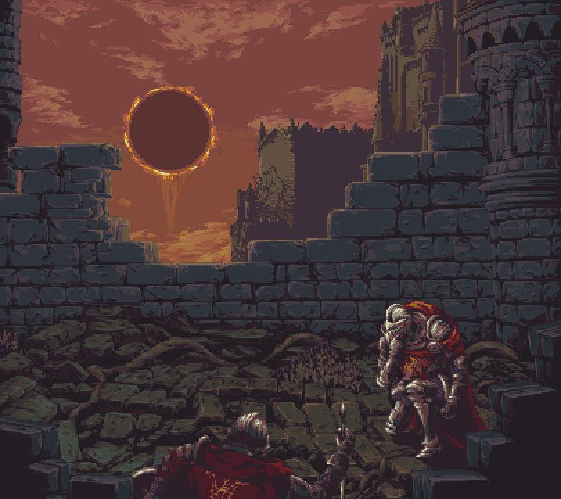

<h1>Wilgleson Francisco Barbosa Dos Santos</h1>

<h2 align="center">
  DESENVOLVEDOR FULL STACK
  
</h2>

 

  

<h2>👨‍💻 Sobre mim</h2>

💻 Estudante de Análise e Desenvolvimento de Sistemas 
☕ Desenvolvendo projetos em Java e Python 
📱 Explorando Desenvolvimento de Apps 
☁️ Aprendendo AWS | arquitetura de software | Machine Learning 

  
  <strong>Fã de Animes Shounen/Seinen </strong>
  &nbsp;&nbsp; | &nbsp;&nbsp;
  
  <strong>SoulsLike Player</strong>
  &nbsp;&nbsp; | &nbsp;&nbsp;
  🎹
  <a href="https://www.youtube.com/watch?v=MBIPsbtBZfA&amp;list=RDMBIPsbtBZfA&amp;start_radio=1&amp;pp=ygURRHJvcCBpbiB0aGUgb2NlYW6gBwE%3D">
    <strong>Gosto de musicas com piano</strong>
  </a>

 

<h2>⚔️ Meu arsenal tecnológico</h2>

  

<h2>📊 Estatísticas do GitHub</h2>

<table>
<tr>
<td align="center" valign="top">

</td>
<td align="center" valign="top">

</td>
</tr>
</table>

 

<h2>🔥 Minha sequência de contribuições</h2>

  

<h2>🚀 Meus projetos</h2>

  

